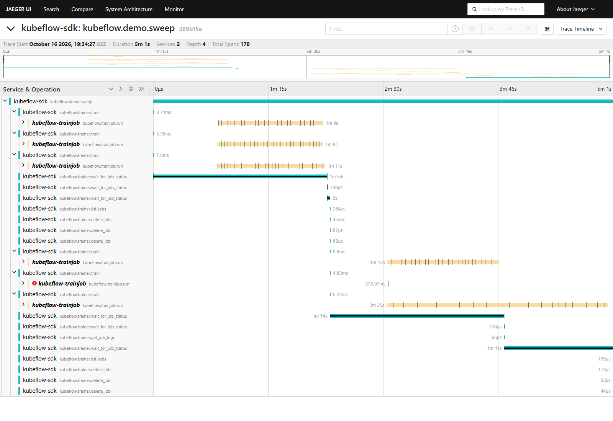
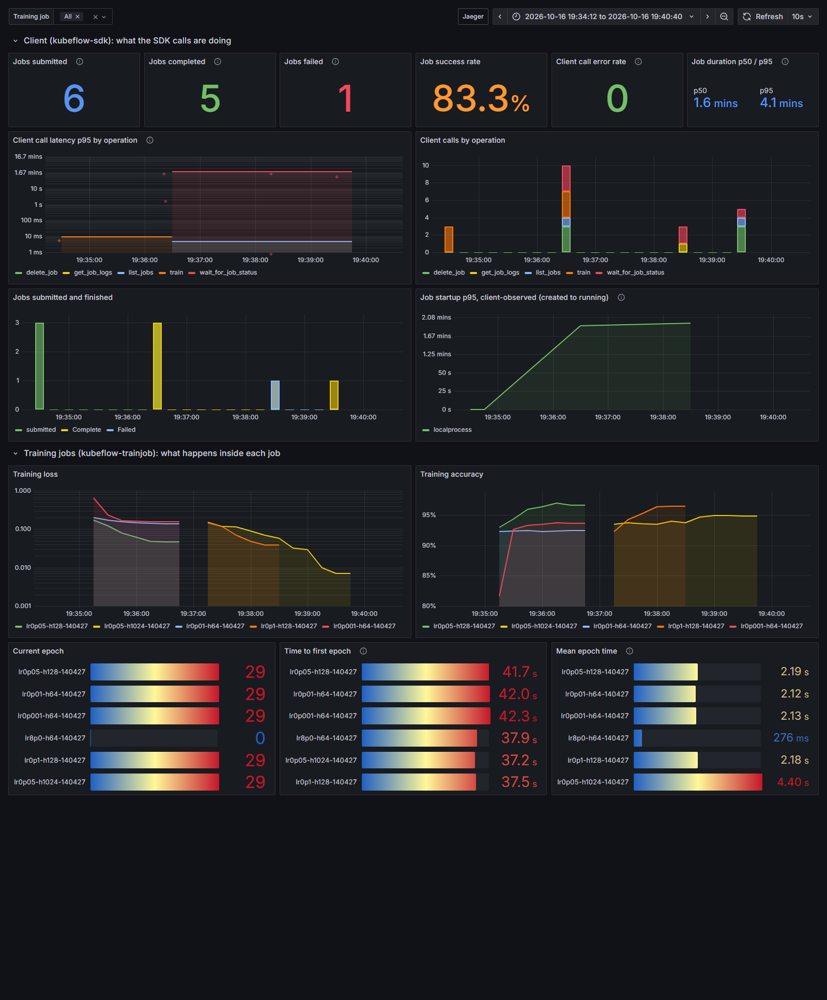

# kubeflow-sdk-otel

**OpenTelemetry tracing and metrics for the [Kubeflow SDK](https://github.com/kubeflow/sdk)**, with a zero-dependency, near-zero-cost no-op default.

> Community project. Not affiliated with or endorsed by the Kubeflow project.

The Kubeflow SDK lets you submit and manage training jobs (`TrainerClient.train()`, `wait_for_job_status()`, ...) from Python, but gives no visibility into what those calls do, how long they take, or how the training jobs behave once they start. This library adds that visibility **without modifying the SDK**:

- **Off by default, free when off.** The core has no required dependencies. Until telemetry is enabled, every instrument is a no-op and OpenTelemetry is never imported. [Measured](docs/performance.md): under 0.4 µs per client call and 19 ms of import time.
- **Standard OpenTelemetry when on.** Spans and metrics go out over OTLP to any OpenTelemetry Collector, so they work with Jaeger, Prometheus, Grafana, or any vendor backend.
- **Plays nicely with existing OpenTelemetry setups.** It never overrides your global providers, and can reuse them if you ask it to.

- **One trace from notebook to training job.** Trace context travels into each TrainJob, so a single trace runs from `client.train()` through every epoch of the job.



*A sweep of six real PyTorch jobs submitted through the Kubeflow SDK ([demo](docs/demo.md)): three run in parallel per batch, each with its epochs as child spans. The diverged job is red, and the large model's run is twice as long. The gap between each `train()` call and its job's first span is environment setup, which turned out to take most of each job's time.*

See [docs/architecture.md](docs/architecture.md) for the design.

## Quick start

```python
from kubeflow.trainer import CustomTrainer, LocalProcessBackendConfig, TrainerClient
from kubeflow_otel import TrainerClientInstrumentor

TrainerClientInstrumentor().instrument()   # or: import kubeflow_otel.auto

client = TrainerClient(backend_config=LocalProcessBackendConfig())
job = client.train(runtime="torch-distributed", trainer=CustomTrainer(func=my_train_fn))
client.wait_for_job_status(job)
```

```bash
KUBEFLOW_OTEL_ENABLED=true OTEL_EXPORTER_OTLP_ENDPOINT=http://localhost:4317 python train.py
```

Every `TrainerClient` call now produces a span (with job status transitions recorded as events while waiting), and the client emits latency, submission, completion and job-duration metrics. See [docs/instrumentation.md](docs/instrumentation.md) for the full list.

### Continue the trace inside the training job

The client passes its trace context to the job through `trainer.env`. Inside the training function:

```python
def my_train_fn():
    from kubeflow_otel.training import training_run

    with training_run() as run:              # joins the trace started by client.train()
        for epoch in range(3):
            with run.epoch(epoch):           # one child span per epoch
                loss = ...
                run.log_metrics({"loss": loss})
```

One trace then spans the notebook's `train()` call and every epoch of the job. See [docs/propagation.md](docs/propagation.md).

## Observability stack

```bash
docker compose -f deploy/docker-compose.yml up -d --wait
python scripts/smoke_test.py      # sends telemetry and verifies it reached every backend
```

| | |
|---|---|
| **Grafana** dashboard "Kubeflow SDK" | http://localhost:3000 |
| **Jaeger** traces | http://localhost:16686 |
| **Prometheus** | http://localhost:9090 |

The OpenTelemetry Collector receives OTLP on `localhost:4317` and fans out traces to Jaeger and metrics to Prometheus (pushed over OTLP, so exemplars survive). The Grafana dashboard covers client latency and errors, the job lifecycle, and per-job training curves, and latency points link straight to their traces. See [docs/observability-stack.md](docs/observability-stack.md).

## Demo: real training jobs

```bash
docker compose -f deploy/docker-compose.yml --profile demo run --rm demo
```

Runs a six-trial PyTorch hyperparameter sweep through the Kubeflow SDK's local-process backend, with one trial that diverges and one deliberate straggler. See [docs/demo.md](docs/demo.md) for what it showed, including two issues it surfaced in the SDK itself.



## On Kubernetes

The same propagation is verified on the SDK's **Kubernetes backend**: a real `TrainJob` on a local kind cluster running Kubeflow Trainer v2.3.0, with an in-cluster OpenTelemetry Collector and Jaeger. One trace spans the client's `train()` and the training pod's run and epochs. See [docs/kubernetes.md](docs/kubernetes.md).

```bash
bash examples/kubernetes/setup.sh   # kind cluster + Kubeflow Trainer + collector + Jaeger
python examples/kubernetes/run_on_kind.py
```

## Performance

| | Telemetry off (default) | Telemetry on |
|---|---|---|
| Per client call | +0.3–0.4 µs | 1.4–2.3× the cost of one bare OpenTelemetry span + metric (~67–190 µs) |
| Per training epoch | +3.6 µs | ~95 µs |
| Import | +19 ms, no OpenTelemetry imported | +179 ms once |

Measured with [`benchmarks/overhead.py`](benchmarks/overhead.py); methodology in [docs/performance.md](docs/performance.md).

## Documentation

| | |
|---|---|
| [Architecture](docs/architecture.md) | Layers, design decisions, testing strategy |
| [Instrumentation](docs/instrumentation.md) | Every span, attribute and client metric |
| [Tracing into jobs](docs/propagation.md) | Context propagation and `training_run()` |
| [Observability stack](docs/observability-stack.md) | Collector, Jaeger, Prometheus, Grafana; exemplars; counting correctly |
| [Demo](docs/demo.md) | The sweep, its results, and SDK issues found |
| [Kubernetes](docs/kubernetes.md) | A traced TrainJob on a kind cluster with Kubeflow Trainer v2.3.0 |
| [Performance](docs/performance.md) | Measured overhead with telemetry off and on, and methodology |

## Install

```bash
pip install "kubeflow-sdk-otel[otel]"      # with OpenTelemetry exporters
pip install kubeflow-sdk-otel              # core only: always no-op
```

## Configuration

| Variable | Default | Meaning |
|---|---|---|
| `KUBEFLOW_OTEL_ENABLED` | `false` | Master switch. |
| `OTEL_SDK_DISABLED` | `false` | Standard OTel kill switch; overrides the above. |
| `OTEL_SERVICE_NAME` | `kubeflow-sdk` | `service.name` of emitted telemetry. |
| `OTEL_EXPORTER_OTLP_ENDPOINT` | `http://localhost:4317` | Collector endpoint (OTLP/gRPC). |
| `KUBEFLOW_OTEL_EXPORTER` | `otlp` | `otlp`, `console` (stdout) or `none`. |
| `OTEL_METRIC_EXPORT_INTERVAL` | `10000` | Metric push interval in ms. |
| `KUBEFLOW_OTEL_SAMPLE_RATIO` | `1.0` | Fraction of new traces sampled (parent-based). |
| `KUBEFLOW_OTEL_PROPAGATE` | `true` | Propagate trace context into submitted jobs. |
| `KUBEFLOW_OTEL_USE_GLOBAL_PROVIDERS` | `false` | Reuse the application's global OTel providers. |

Invalid values never raise. A warning is logged and the default is used, because telemetry must never break the application it observes.

## Using the telemetry API directly

```python
import kubeflow_otel

telemetry = kubeflow_otel.get_telemetry()        # configured from the environment
with telemetry.tracer.start_span("my-step", attributes={"dataset": "mnist"}):
    ...
telemetry.meter.create_counter("my.events").add(1)
```

## Development

```bash
python -m venv .venv && . .venv/bin/activate
pip install -e ".[dev]"
pytest
ruff check src tests scripts examples benchmarks && ruff format --check src tests scripts examples benchmarks
python scripts/build_dashboard.py --check   # dashboard JSON matches its generator
```

## License

Apache-2.0
